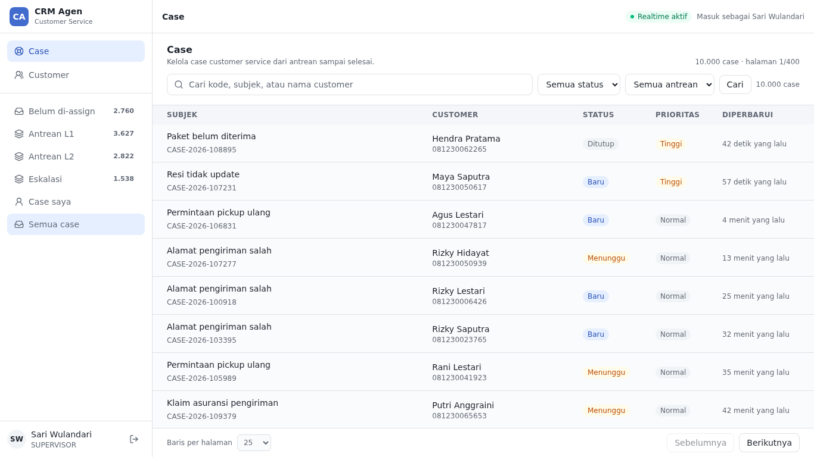
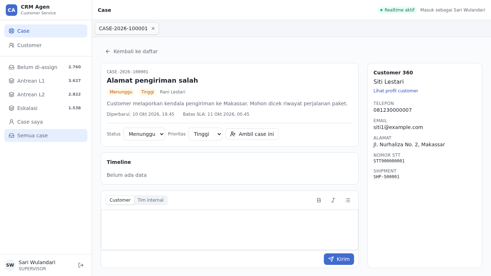

# crm-frontend

> Starter kit for a customer-service agent console (CRM): React 19, Vite, TanStack, MSW. Runs fully on a mock backend.

Kerangka frontend untuk **konsol agen customer service**: daftar case dengan filter dan ribuan baris,
detail case dengan timeline dan balasan rich text, profil customer, dan hak akses per peran. Seluruh
backend ditiru oleh mock di browser, jadi proyek ini langsung jalan tanpa server apa pun.

Istilah: **agen CS** adalah staf customer service yang memakai konsol ini; **AI agent** adalah asisten kode (lihat bagian terakhir). Nama app `crm-console` merujuk ke konsolnya, yang akan dipakai banyak tim, bukan ke agen CS.

Cocok dipakai sebagai titik awal tim frontend: pola data, routing, keamanan, tes, dan CI sudah
tertata, tinggal menambah modul.

|                                           |                                             |
| ----------------------------------------- | ------------------------------------------- |
|  |  |

## Isi singkat

- **Modul Case** (acuan lengkap) dan **Customer** (acuan minimal): daftar, detail, filter yang tersimpan di URL, tab case terbuka, balasan rich text, indikator real-time (SSE), dan form "Case baru" (React Hook Form + Zod) sebagai contoh form.
- **Hak akses per peran** (L1, L2, supervisor, admin) dan **masking data pribadi**: server memasking, UI memasking lagi sebagai lapisan kedua.
- **Sesi aman:** cookie `HttpOnly` lewat BFF, token CSRF, sesi habis ditangani di satu tempat, logout menjalar ke semua tab.
- **Dua bahasa** (`id-ID`, `en-US`), aksesibilitas WCAG 2.1 AA (dipindai axe di e2e), dan budget ukuran bundle per route.
- **Tes dan CI:** Vitest, Testing Library, Playwright; lint, typecheck, cakupan, build, dan image Docker diperiksa di setiap PR.
- **Generator modul:** `pnpm new:module` membuat kerangka modul baru lengkap dengan route dan guard izin.
- **Generator endpoint:** `pnpm new:endpoint` menyambungkan satu endpoint GET (kontrak, klien, facade, query hook, mock, tabel status) dalam satu perintah.

**Stack:** React 19 · Vite 8 · TypeScript strict · TanStack Router/Query/Table/Virtual · Zustand · Tailwind CSS 4 · Zod · React Hook Form · Tiptap · i18next · MSW · Vitest · Playwright · pnpm workspace.

## Mulai cepat

Butuh Node >= 22.12 (lihat `.nvmrc`) dan pnpm >= 12 (`corepack enable`).

```bash
pnpm install
cp apps/crm-console/.env.example apps/crm-console/.env.local
pnpm dev            # http://localhost:5173
```

Aplikasi langsung masuk sebagai **supervisor** (sesi mock). Untuk mencoba peran lain, ubah
`VITE_MOCK_ROLE` di `.env.local` menjadi `l1`, `l2`, atau `admin`.

Sebelum membuat PR, jalankan `pnpm check`.

Untuk menjalankan e2e (`pnpm test:e2e`), pasang browser Playwright sekali:

```bash
pnpm --filter @crm/crm-console exec playwright install chromium
# Linux/WSL yang baru: tambahkan --with-deps (butuh sudo), seperti di CI
```

Langkah ini tidak diperlukan untuk `pnpm dev` atau `pnpm check`.

## Perintah

| Perintah                            | Fungsi                                                                                          |
| ----------------------------------- | ----------------------------------------------------------------------------------------------- |
| `pnpm dev`                          | Dev server dengan backend mock                                                                  |
| `pnpm check`                        | sama dengan CI: format, lint, typecheck, test, build, size, drift codegen (jalankan sebelum PR) |
| `pnpm test`                         | Unit/komponen (Vitest) + lantai cakupan (`vitest.config.ts`)                                    |
| `pnpm test:e2e`                     | E2E Playwright (dev server + MSW), termasuk pindai axe WCAG AA                                  |
| `pnpm size`                         | Cek budget bundle (initial JS dan tiap route <= 300 KB gzip)                                    |
| `pnpm --filter @crm/crm-console perf` | Ukur performa terhadap build harness (opsional, lambat; `--grep heap` untuk heap)               |
| `pnpm codegen:api`                  | Generate ulang klien dari `packages/api-client/openapi/`                                        |
| `pnpm new:module`                   | Buat kerangka modul baru (lihat bagian di bawah)                                                |
| `pnpm new:endpoint`                 | Tambah endpoint GET ke satu modul (`docs/agents/recipes.md`)                                    |
| `pnpm format`                       | Prettier (`pnpm format:check` untuk cek saja, dipakai CI)                                       |

## Cara kerjanya

```text
apps/crm-console/src
  routes/        # URL; tipis, hanya merangkai halaman dari modul
  modules/<id>/  # satu folder per fitur CRM (case, customer, ...)
  app/           # shell aplikasi: layout, login, daftar modul
  lib/           # helper umum
  mocks/         # backend tiruan (hanya dev)
packages/
  ui/            # komponen dan token desain bersama (@crm/ui)
  api-client/    # tipe dan klien dari kontrak OpenAPI
  auth/          # peran, izin, masking data pribadi
  i18n/          # teks id-ID dan en-US
  test-utils/    # bantuan untuk tes
```

Tiga aturan utama. Aturan 1 dan larangan `fetch` di komponen ditegakkan ESLint; sisanya dijaga lewat resep, tes, dan review:

1. **Modul saling terpisah.** Satu modul tidak boleh mengimpor modul lain kecuali lewat `public.ts`-nya.
2. **Data server hanya di TanStack Query.** Tidak ada `fetch` di komponen dan tidak ada data server di Zustand.
3. **Filter hidup di URL**, jadi tampilan bisa di-bookmark dan dibagikan.

### Menambah modul

```bash
pnpm new:module invoice --path /invoices --icon Receipt --permission invoice.view
```

Perintah itu membuat folder modul, route tipis dengan guard izin, dan mendaftarkannya di navigasi.
Langkah lanjutan (izin, teks, endpoint, mock) ada di [docs/agents/recipes.md](docs/agents/recipes.md).

## Status dan batasan

- **Backend belum ada di repo ini.** Semua data berasal dari mock (MSW). Kontrak API di `packages/api-client/openapi/openapi.yaml` masih sementara; tipe dan klien di-generate darinya. Status tiap endpoint ada di [docs/contract-status.md](docs/contract-status.md).
- **Domain masih generik** (4 status, antrean l1/l2/escalated, 4 peran). Perlakukan sebagai contoh pola, bukan model final.
- **Belum ada pelaporan error ke layanan eksternal.** Error baru masuk `console.error`; titik pasang SDK sudah disediakan (`setErrorReporter`).
- **CSP masih Report-Only**, dan login memakai sesi mock sampai backend tersedia.

## Docker

```bash
docker build -t crm-console .
docker run -p 8080:8080 crm-console        # http://localhost:8080
```

Image berisi hasil build statis yang dilayani nginx di port 8080, dengan header keamanan di
`security-headers.inc`. Aplikasi diasumsikan same-origin di belakang BFF.

- Build arg `VITE_API_BASE_URL` (default `/`) dan `VITE_TELEMETRY_URL` tertanam di bundle; keduanya publik, jangan isi secret.
- MSW hanya jalan di dev server. File `*.map` dan `mockServiceWorker.js` dihapus dari image.

## Kontribusi

- **Branch:** `feature/`, `bugfix/`, `hotfix/`, `release/`. Alur: `development` -> `staging` -> `master`.
- **Commit:** Conventional Commits (`feat`, `fix`, `docs`, `test`, `chore`, ...).
- **PR:** buka dari feature branch ke `development`, ikuti template di `.github/`, dan lolos CI: `format:check`, `pnpm check`, drift klien OpenAPI (`pnpm codegen:api` tanpa diff), e2e, dan build image Docker.
- **Pre-commit:** Husky menjalankan `lint-staged` (ESLint + Prettier pada file yang berubah). Aktif otomatis setelah `pnpm install`.
- **Bahasa:** kode, komentar, nama tes, dan commit dalam bahasa Inggris; README dan teks produk (`id-ID`) dalam bahasa Indonesia. Kebijakan lengkap di [AGENTS.md](AGENTS.md).

## Dokumentasi

- [AGENTS.md](AGENTS.md): aturan, perintah verifikasi, dan perangkap yang sering terjadi.
- [docs/agents/recipes.md](docs/agents/recipes.md): langkah per jenis tugas (endpoint, modul, halaman, form, komponen UI, izin, tes).
- [docs/contract-status.md](docs/contract-status.md): endpoint mana yang stabil, sementara, atau masih usulan.
- [docs/adr/](docs/adr/README.md): catatan keputusan arsitektur (ADR) beserta alasannya.

## Untuk AI agent

Aturan, perintah verifikasi, dan perangkap yang sering terjadi ada di [AGENTS.md](AGENTS.md); langkah
per jenis tugas (endpoint, modul, route, teks, izin, tes) ada di [docs/agents/recipes.md](docs/agents/recipes.md).
`CLAUDE.md` hanya mengimpor `AGENTS.md`. Sebuah tes menjaga agar path yang disebut di dokumen itu
tetap ada, dan agar tabel `docs/contract-status.md` memuat semua endpoint di `openapi.yaml`.
