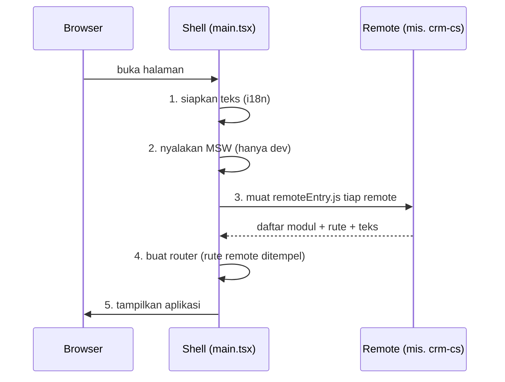
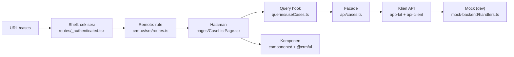
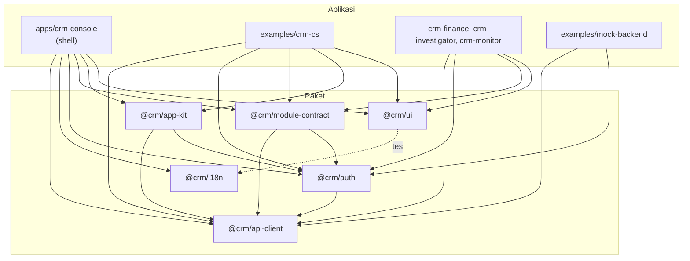
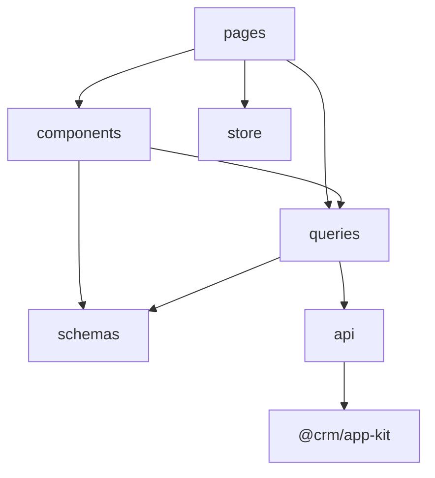

# Panduan onboarding developer frontend

Untuk siapa: developer frontend yang baru pertama kali membuka repo ini. Kamu tidak perlu tahu apa itu
micro frontend lebih dulu. Waktu baca sekitar 20 menit; sisanya adalah latihan kecil di bagian 12.

Aturan teknis lengkap ada di [AGENTS.md](../AGENTS.md), langkah per jenis tugas di
[docs/agents/recipes.md](agents/recipes.md), dan alasan di balik desainnya di
[docs/system-design.md](system-design.md). Dokumen ini adalah pintu masuknya: ia menjelaskan **di mana
sesuatu berada dan siapa bergantung pada siapa**.

## 1. Gambaran dalam satu menit

- Repo ini **monorepo**: banyak aplikasi dan paket dalam satu repositori, dikelola dengan pnpm workspace.
- Ada satu aplikasi utama, **`apps/crm-console`**, yang kita sebut **shell**. Isinya hanya kerangka:
  login, sesi, menu, dan router. **Shell tidak punya layar bisnis.**
- Layar bisnis (daftar case, profil customer, dan seterusnya) ada di **remote**: aplikasi terpisah yang
  dimuat shell ketika halaman dibuka. Remote contohnya ada di `examples/`.
- Kode yang dipakai bersama (komponen UI, klien API, izin) ada di **`packages/`**.
- Semua data berasal dari **mock** (MSW) yang berjalan di browser, jadi kamu tidak butuh backend.

Bayangkan shell sebagai bangunan kosong dengan listrik, pintu, dan lorong. Remote adalah ruangan yang
dipasang ke bangunan itu. Tujuan repo ini: bangunannya dipakai ulang, ruangannya diganti sesuai produk.

## 2. Istilah yang akan sering muncul

| Istilah           | Artinya di repo ini                                                                                                       |
| ----------------- | ------------------------------------------------------------------------------------------------------------------------- |
| Shell             | `apps/crm-console`: login, layout, menu, router. Tidak berisi layar bisnis                                                |
| Remote            | Aplikasi terpisah yang dimuat shell saat start dan menyumbang menu serta layar                                            |
| Modul             | Satu fitur dalam sebuah remote (misalnya `case`, `customer`): punya menu, izin, halaman, dan data                         |
| Contoh (example)  | Remote yang disertakan untuk belajar, di `examples/`. Bukan bagian boilerplate                                            |
| Module Federation | Teknik (plugin Vite) yang membuat shell bisa memuat kode remote saat runtime                                              |
| Singleton         | Library yang harus hanya ada satu salinannya di halaman (React, router, query cache), dibagi shell ke remote              |
| Facade            | File tipis di `api/` yang membungkus panggilan API; komponen hanya boleh lewat sini                                       |
| Query hook        | Fungsi `useXxx` di `queries/` (TanStack Query) yang mengambil dan menyimpan data server                                   |
| Mock / MSW        | Backend tiruan di browser (hanya saat dev). Mencegat request `/v1/...`                                                    |
| BFF               | Backend yang dipanggil frontend (Go). Belum ada di repo ini; frontend menganggap kontraknya di `openapi.yaml`             |
| Peran dan izin    | Peran (`l1`, `l2`, `supervisor`, `admin`) memegang izin (`case.view`, ...). UI hanya menyembunyikan; server tetap penjaga |
| Master data       | Daftar status, antrean, dan prioritas yang datang dari API, bukan ditulis di kode                                         |

## 3. Peta folder

```text
apps/
  crm-console/            SHELL. Satu-satunya aplikasi di apps/ (remote baru dari `pnpm new:remote` juga ke sini)
    src/main.tsx          titik masuk: urutan start (lihat bagian 4)
    src/router.tsx        membuat router setelah remote dimuat
    src/routes/           halaman milik shell (login, layout ber-sesi, halaman awal)
    src/app/              layout, sesi, daftar modul, pemuat remote
    src/mocks/            worker MSW, sesi dan logout tiruan (tanpa data bisnis)
    e2e/                  tes e2e shell sendiri (tanpa remote)
examples/
  crm-cs/                 CONTOH LENGKAP: modul Case dan Customer (acuan utama untuk belajar)
  crm-finance/ ...        tiga contoh kecil: satu halaman per remote
  mock-backend/           data dan handler tiruan untuk semua contoh
  e2e/                    tes alur lintas shell dan contoh
packages/
  ui/                     komponen dan token desain (@crm/ui): Button, Table, Card, ...
  app-kit/                helper bersama shell dan remote: klien API, format, SSE, guard izin
  api-client/             tipe dan klien yang dibuat dari kontrak OpenAPI
  auth/                   peran, izin, masking data pribadi, AuthProvider
  i18n/                   teks id-ID dan en-US milik shell
  module-contract/        tipe "apa yang diekspor sebuah remote"
  test-utils/             bantuan untuk tes
  config-ts/ config-eslint/   konfigurasi bersama
docs/                     dokumentasi (kamu sedang membacanya)
```

Cara mengingatnya: **`apps/` = yang dijalankan, `examples/` = yang ditiru, `packages/` = yang dipakai bersama.**

## 4. Apa yang terjadi saat halaman dibuka

Urutan ini ada di `apps/crm-console/src/main.tsx`. Pahami urutannya, karena banyak keputusan desain
berasal dari sini.



Akibat yang perlu kamu ingat:

- **Router dibuat setelah remote dimuat.** Karena itu rute `/cases` tidak ada di `routeTree.gen.ts`, dan
  `<Link to="/cases">` di shell tidak dicek tipenya.
- **Remote yang gagal dimuat tidak merusak shell.** Shell tetap menyala, menampilkan banner "Sebagian
  layar gagal dimuat" dan layar kosong bila tidak ada modul sama sekali.
- **Remote tidak ditulis di kode shell.** Daftarnya datang dari `VITE_REMOTE_MODULES` (pasangan
  `nama=url`). Itu sebabnya `pnpm dev` menampilkan layar kosong, sedangkan `pnpm dev:examples` menampilkan
  menu.

## 5. Ikuti satu layar dari URL sampai data

Contoh: pengguna membuka **daftar case** (`/cases`). Buka file-file ini berurutan di editor; itu cara
tercepat untuk memahami bentuk kodenya.



1. **Shell memeriksa sesi.** `apps/crm-console/src/routes/_authenticated.tsx` memanggil
   `app/auth/session.ts`, yang meminta `/v1/session`. Tanpa sesi, pengguna dialihkan ke `/login`.
2. **Remote menyumbang rute.** `examples/crm-cs/src/routes.ts` mendefinisikan `cases`: ia memvalidasi
   parameter di URL dengan zod (`modules/case/schemas/search.ts`) dan memasang `CaseListPage`.
3. **Halaman membaca filter dari URL**, bukan dari state lokal: `pages/CaseListPage.tsx` memakai
   `searchRoute` (`examples/crm-cs/src/lib/search-route.ts`). Itu sebabnya halaman bisa di-bookmark.
4. **Halaman meminta data lewat query hook**: `useCases(search)` di `queries/useCases.ts` (TanStack Query).
5. **Query hook memanggil facade**: `api/cases.ts` membungkus `api.listCases(...)`.
6. **Facade memakai klien API bersama**: `api` dibuat di `packages/app-kit/src/api.ts` (dengan token CSRF
   dan penanganan error), tipenya dari `packages/api-client/src/index.ts`, yang dibuat dari kontrak
   `packages/api-client/openapi/openapi.yaml`.
7. **Saat dev, MSW mencegat request itu**: `examples/mock-backend/src/handlers.ts` menjawab dari
   `db.ts`, dan `mask.ts` menyamarkan data pribadi sesuai peran.
8. **Hasilnya tampil lewat komponen**: `components/CaseTable.tsx` dan komponen dari `@crm/ui`; teksnya
   dari `t('...')` dengan isi di `examples/crm-cs/src/texts.ts`.

**Aturan emas:** komponen tidak pernah memanggil `fetch` atau `api` langsung. Urutannya selalu
**halaman, query hook, facade, klien API**. ESLint menolak `fetch` di `modules/`, `components/`, dan `routes/`.

## 6. Siapa boleh memakai siapa (dependensi antar paket)



Panah berarti "memakai". Tiga aturan sederhana:

1. **Aplikasi boleh memakai paket; paket tidak boleh memakai aplikasi.** (`packages/ui` dan `packages/app-kit`
   tidak boleh mengimpor aplikasi apa pun.)
2. **Remote tidak mengimpor shell.** Yang dibutuhkan keduanya ditaruh di sebuah paket (karena itu ada
   `@crm/app-kit`). Kalau kamu ingin mengimpor `@/lib/...` milik shell dari remote, berhentilah: pindahkan
   kodenya ke paket.
3. **Shell tidak mengimpor `examples/`.** Hubungannya hanya lewat konfigurasi saat dev
   (`VITE_REMOTE_MODULES` dan `MOCK_DOMAIN`), bukan lewat `import`.

Satu catatan: yang "dibagi" saat runtime (satu salinan di halaman) adalah `react`, `react-dom`,
`react-i18next`, `@tanstack/react-query`, `@tanstack/react-router`, `@crm/app-kit`, `@crm/auth`, dan
`@crm/ui`. Shell mendaftarkan semuanya di `vite.config.ts`. Sebuah remote mendaftarkan **yang ia impor**:
`examples/crm-cs` memakai kedelapannya, sedangkan tiga contoh kecil hanya enam (tanpa router dan `@crm/app-kit`).
Remote tidak boleh mendaftarkan sesuatu yang tidak dibagi shell (dijaga tes `shared-libs.test.mjs`).

Diagram di atas hanya menggambar dependensi `dependencies`; dependensi untuk tes atau pengukuran (misalnya
`@crm/test-utils`, atau `@crm/example-mock-backend` untuk harness perf) tidak digambar. Dijaga tes `agent-docs.test.mjs`.

## 7. Aturan impor di dalam satu aplikasi

Di dalam `examples/crm-cs/src/modules/`, ESLint menegakkan batas ini:

- Modul **tidak boleh** mengimpor modul lain, kecuali lewat `@/modules/<lain>/public` (isinya hanya query,
  skema, dan store; bukan komponen).
- Modul **tidak boleh** mengimpor `app/` atau `routes/`.
- Lintas folder dalam satu modul memakai alias `@/modules/<modul>/...`. Path relatif tidak boleh naik
  dengan `../../`.
- Tautan antar modul lewat rute (`<Link to="/customers/$customerId">`), bukan impor komponen.

Kalau sebuah file dipakai tiga modul atau lebih, pindahkan ke `packages/`.

## 8. Anatomi satu modul

Contoh: `examples/crm-cs/src/modules/case/`.

```text
module.ts      mendaftarkan modul ke shell: id, menu, ikon, izin, sidebar, tab, hook real-time
public.ts      satu-satunya pintu masuk bagi modul lain (query, skema, store)
pages/         satu file per halaman; merangkai komponen dan query hook
components/    potongan UI milik modul ini (tabel, form, badge)
queries/       query hook TanStack Query + kunci cache (keys.ts)
api/           facade: satu-satunya tempat memanggil klien API
schemas/       skema zod: parameter URL, form, event
store/         state UI saja (tab terbuka, draf balasan), dengan Zustand
```

Arah ketergantungan di dalam modul, dari atas ke bawah (jangan dibalik):



## 9. Di mana data disimpan

| Jenis data                         | Disimpan di                              | Catatan                                                    |
| ---------------------------------- | ---------------------------------------- | ---------------------------------------------------------- |
| Data dari server (case, customer)  | TanStack Query (cache)                   | Lewat query hook. Tidak disalin ke Zustand                 |
| Filter, halaman, urutan            | URL (search params + zod)                | Bisa di-bookmark dan dibagikan; `.catch()` untuk URL usang |
| State tampilan (tab terbuka, draf) | Zustand di `store/`                      | Hanya UI. Dibersihkan saat logout lewat `onSignOut`        |
| Isi form                           | React Hook Form + skema zod              | Pesan galat berupa kunci i18n                              |
| Sesi login                         | Cookie `HttpOnly` lewat BFF              | Tidak pernah di `localStorage`; CSRF lewat header          |
| Teks tampilan                      | `texts.ts` remote atau `@crm/i18n` shell | Dua bahasa, dijaga tes                                     |

## 10. Peran, izin, dan data pribadi

- Peran dan izin ada di `packages/auth/src/roles.ts` (satu tabel). Di komponen pakai `<Can>` atau
  `can(...)`; di rute pakai `requirePermission` (dari `@crm/app-kit`). **Jangan menulis `role === '...'`.**
- UI hanya **menyembunyikan**. Penjaga sebenarnya adalah server.
- Data pribadi (telepon, email, alamat) disamarkan **oleh server**. Mock di
  `examples/mock-backend/src/mask.ts` meniru itu, dan UI memanggil `maskPhone`/`maskEmail`/`maskAddress`
  sebagai lapisan kedua.

## 11. Aku ingin mengerjakan... maka buka

| Tujuan                               | Mulai dari                                                                              |
| ------------------------------------ | --------------------------------------------------------------------------------------- |
| Mengubah teks atau judul             | `examples/crm-cs/src/texts.ts` (layar CS) atau `packages/i18n/src/resources.ts` (shell) |
| Menambah kolom atau filter di daftar | `modules/case/components/` dan `schemas/search.ts`, lalu `queries/` bila datanya baru   |
| Menambah endpoint GET                | `pnpm new:endpoint`, lalu recipe "Add an API endpoint" di `docs/agents/recipes.md`      |
| Menambah halaman                     | recipe "Add a page or route"; rutenya di `examples/crm-cs/src/routes.ts`                |
| Membuat aplikasi remote baru         | `pnpm new:remote <id>`, lalu recipe "Add a remote"                                      |
| Menambah komponen UI bersama         | `packages/ui/src/` (ekspor, tes, dan masukkan ke galeri `/design-system`)               |
| Menambah izin atau peran             | `packages/auth/src/roles.ts`                                                            |
| Mengubah data tiruan                 | `examples/mock-backend/src/` (data di `db.ts`, handler di `handlers.ts`)                |
| Memahami keputusan arsitektur        | `docs/adr/` (satu berkas per keputusan, dengan alasannya)                               |

## 12. Latihan pertama (sekitar 30 menit)

Jalankan `pnpm dev:examples`, buka http://localhost:5173, lalu kerjakan berurutan. Setelah tiap langkah, jalankan
`pnpm lint && pnpm typecheck`.

1. **Ubah satu teks.** Ganti judul daftar case di `examples/crm-cs/src/texts.ts` (id-ID **dan** en-US),
   dan lihat hasilnya. Lalu hapus salah satu kunci di en-US dan jalankan
   `pnpm exec vitest run examples/crm-cs/src/texts.test.ts`: tes harus gagal. Kembalikan.
2. **Ikuti satu request.** Buka tab Network, muat ulang `/cases`, temukan `GET /v1/cases`, lalu cari di
   `examples/mock-backend/src/handlers.ts` handler yang menjawabnya.
3. **Coba peran lain.** Tambahkan `?role=l1` di URL. Menu Customer menghilang; cari di
   `packages/auth/src/roles.ts` kenapa.
4. **Remote yang tidak bisa dijangkau.** Jalankan `VITE_REMOTE_MODULES=crm_cs=http://localhost:5999/remoteEntry.js pnpm dev`
   (alamat itu sengaja salah): lihat banner dan layar kosong, dan baca pesannya di konsol browser.
5. **Buat remote.** `pnpm new:remote latihan`, jalankan seperti yang dicetak, lihat menunya muncul, lalu
   hapus folder `apps/crm-<nama>` yang baru dibuat dan jalankan `git checkout pnpm-lock.yaml`.

## 13. Jebakan yang sering menjebak pemula

- **`pnpm dev` menampilkan layar kosong.** Itu benar: shell tanpa remote. Pakai `pnpm dev:examples`.
- **Start pertama `pnpm dev:examples` lambat dan bisa menampilkan banner remote gagal.** Cache Vite masih kosong;
  tunggu semua server mencetak `ready`, lalu muat ulang. Start berikutnya cepat.
- **Sesi mock hilang saat halaman dimuat ulang.** Data tiruan ada di memori halaman. Di tes e2e pindah
  halaman lewat `clientNavigate`, jangan `page.goto` setelah login.
- **Layar remote berantakan (kolom bertumpuk, tanpa gaya)** biasanya berarti kelas Tailwind remote tidak ikut dibuat shell.
  Periksa pola `@source` di `apps/crm-console/src/styles.css`; tes `examples/e2e/cs/styles.spec.ts` menjaganya.
- **Kelas Tailwind baru di remote tidak terlihat.** Shell yang membangun satu lembar gaya untuk semua; di dev
  biasanya cukup memuat ulang, di produksi shell perlu dibangun ulang.
- **`routeTree.gen.ts` jangan diedit tangan.** Ia dibuat otomatis oleh `pnpm dev` atau build.
- **Link ke rute remote tidak dicek tipenya** di shell (lihat bagian 4).
- **ESLint menolak `<button>`, `<input>`, dan warna Tailwind mentah.** Pakai komponen dari `@crm/ui` dan
  token desain (`docs/ui-standards.md`).
- **Library yang dibagi harus didaftarkan di shell dan di remote yang mengimpornya.** Kalau remote mengimpor
  `@tanstack/react-router` tanpa mendaftarkannya, ia membawa salinannya sendiri dan hook router tidak lagi
  melihat router shell.
- **Tes e2e berjalan dengan 2 worker dengan sengaja.** Menaikkannya bisa membuat tes gagal di mesin 8 GB.

## 14. Bacaan lanjutan, urut

1. [docs/agents/recipes.md](agents/recipes.md): langkah rinci tiap jenis tugas.
2. [docs/system-design.md](system-design.md): alasan desain dan batas arsitektur.
3. [docs/ui-standards.md](ui-standards.md): aturan UI dan komponen.
4. [docs/adr/](adr/README.md): keputusan besar dan alasannya, terutama ADR-0009 (micro frontend).
5. [examples/README.md](../examples/README.md): detail contoh dan cara kerja Module Federation di repo ini.
6. [docs/production-readiness.md](production-readiness.md): catatan persiapan production.
