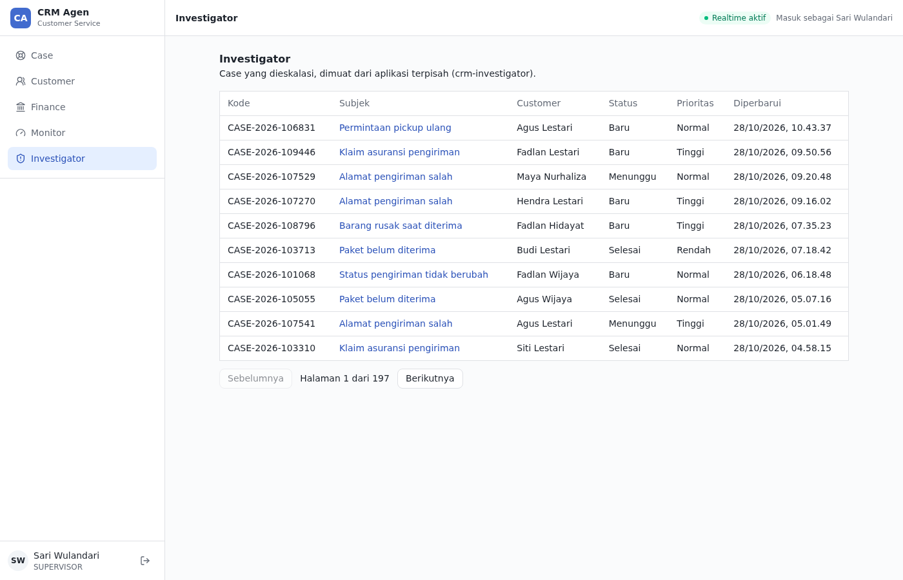
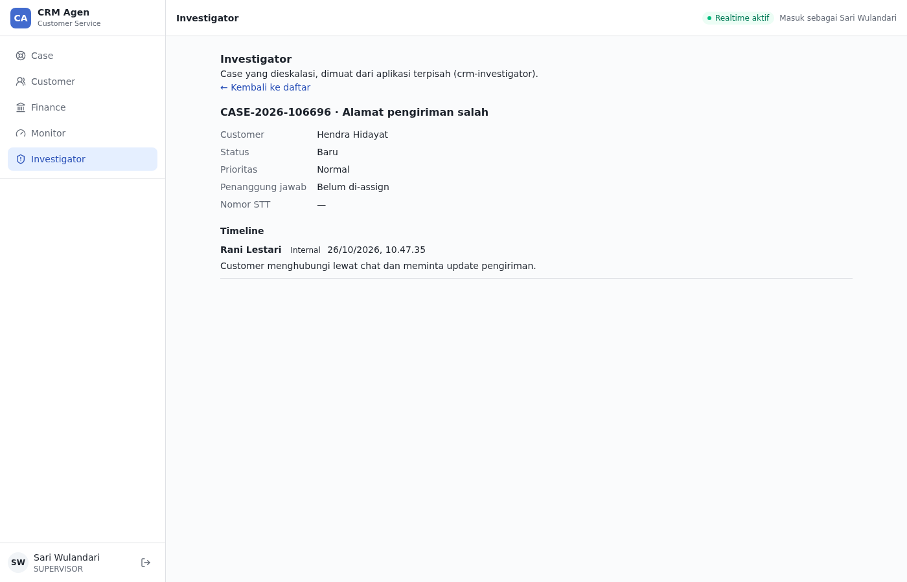
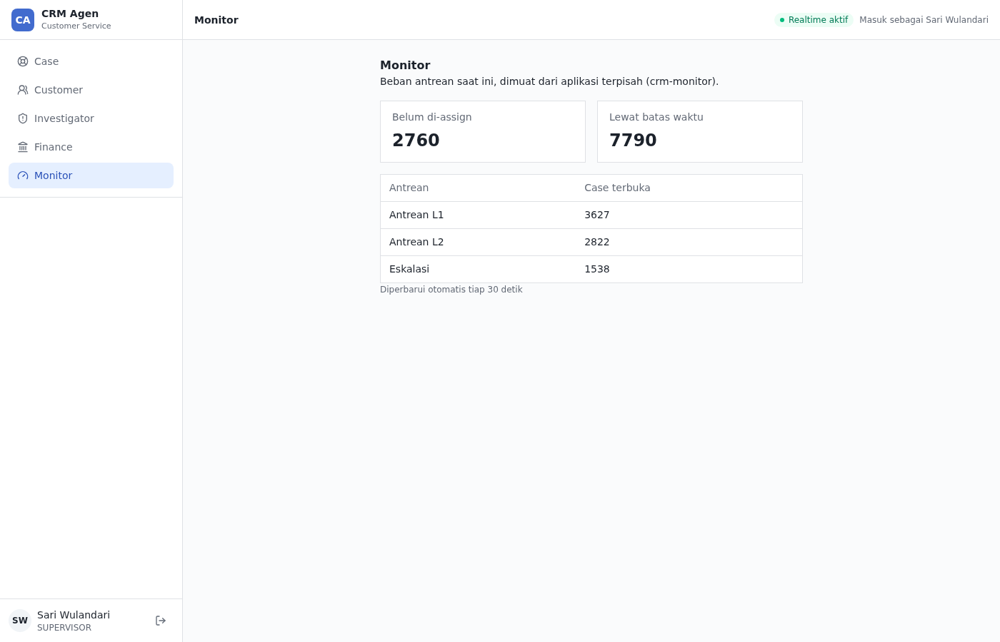

# Micro frontend PoC

Status: proof of concept on a feature branch. It answers "can this app be split into micro
frontends?" with a working host and three remotes that behave like separate teams' modules. It is
not an accepted architecture decision; if the team adopts it, record that as an ADR
(`docs/adr/README.md`).

| Investigator (list)                                       | Investigator (detail)                                         |
| --------------------------------------------------------- | ------------------------------------------------------------- |
|  |  |
| **Monitor**                                               | **Finance**                                                   |
|                      |                          |

## The remotes

| App                     | Port (dev / preview) | Module id      | Needs permission | Shows                                                                  |
| ----------------------- | -------------------- | -------------- | ---------------- | ---------------------------------------------------------------------- |
| `apps/crm-finance`      | 5174 / 4175          | `finance`      | none             | Placeholder: what a remote shares with the host (session, cache, i18n) |
| `apps/crm-investigator` | 5175 / 4176          | `investigator` | `case.escalate`  | Escalated cases: list with pagination, then detail with the timeline   |
| `apps/crm-monitor`      | 5176 / 4177          | `monitor`      | `case.reassign`  | Queue load: unassigned, overdue, open cases per queue                  |

Investigator and Monitor use only data that already exists in the contract (`GET /v1/cases`,
`GET /v1/cases/{caseId}`, `GET /v1/cases/summary`, `GET /v1/master-data`). Finance has no data
because the contract has none for it; nothing was invented.

**The permissions are stand-ins.** `case.escalate` (L2, supervisor, admin) and `case.reassign`
(supervisor, admin) already exist in `packages/auth/src/roles.ts` and were reused so the PoC makes
no business decision. A dedicated permission per team is for the product owners to decide. The
escalation queue code `escalated` is an assumption on the provisional contract; if master data does
not have it, Investigator says so instead of showing another queue.

## What it proves

| Claim                                                                 | Evidence                                                                                                                            |
| --------------------------------------------------------------------- | ----------------------------------------------------------------------------------------------------------------------------------- |
| Separate apps plug modules into the console at runtime                | Each remote is built and served on its own; the host loads its `remoteEntry.js` in the browser                                      |
| Remotes appear in the navigation through the existing module contract | Each remote exports a module definition (id, label key, icon, path, permission)                                                     |
| One React, one session, one `QueryClient`, one i18n instance          | Remote pages use hooks, show the signed-in user, and write to the host cache; no React chunk is downloaded per remote               |
| A remote can ship on its own                                          | Change a remote, rebuild only that app, reload the host: the change shows, the host is untouched                                    |
| Different teams see different things                                  | See the role matrix below, including direct URLs                                                                                    |
| A remote can own routes under its prefix                              | Investigator has a list at `/remote/investigator` and details at `/remote/investigator/case/<id>`; deep links survive a hard reload |
| Remotes use the host's API client                                     | Same session, CSRF handling, and PII masking as built-in modules; no second client                                                  |
| Failures are contained                                                | Stop one remote: the others and the host keep working. Stop all: the host works, remote paths show "Modul tidak tersedia"           |
| The host's session handling covers remotes                            | A 401 on a remote's query sends the user to `/login?redirect=/remote/...`; signing out clears the remotes' cached data              |
| The menu is stable                                                    | Remotes load in parallel but register in the configured order, so the menu does not depend on which answered first                  |

### Role matrix (mock roles, `VITE_MOCK_ROLE`)

| Role         | Menu                                           | `/remote/investigator` | `/remote/monitor` |
| ------------ | ---------------------------------------------- | ---------------------- | ----------------- |
| `l1`         | Case, Finance                                  | redirected to `/cases` | redirected        |
| `l2`         | Case, Customer, Finance, Investigator          | opens                  | redirected        |
| `supervisor` | Case, Customer, Finance, Investigator, Monitor | opens                  | opens             |

## How it works

```text
packages/module-contract   types only: RemoteModule (what a remote exports), RemotePageProps (what it gets)
apps/crm-console             host: shell, session, routing, shared singletons
  vite.config.ts             federation plugin, no remote listed (the build does not need one)
  src/app/modules/remote.ts      reads VITE_REMOTE_MODULES, loads each `<name>/module`, registers in order
  src/app/modules/registry.ts    registerRemoteModule(): ignores an id or path that is taken, with a warning
  src/app/modules/guard.ts       beforeLoad guard: permission comes from the loaded module
  src/app/modules/RemoteModulePage.tsx   gives the page `api`, `subPath`, `navigate`; or "unavailable"
  src/routes/_authenticated/remote/$moduleId/   index and splat routes, one pair for every remote
apps/crm-finance, crm-investigator, crm-monitor   remotes: expose ./module, add their own i18n texts
```

- **Tool:** `@module-federation/vite` 1.23.5 (Vite 8 is in its peer range) and
  `@module-federation/runtime` 2.9.2 in the host, both pinned.
- **Runtime registration:** the host does not know a remote at build time. URLs come from
  `VITE_REMOTE_MODULES` (`name=entryUrl`, comma separated; empty means no remotes), so one host
  build can point to different remotes per environment.
- **What the host gives a remote page** (`RemotePageProps`): `api` (the host's API client),
  `subPath` (the path below `/remote/<id>/`), and `navigate(subPath)` (moves inside the host router
  without a reload). Remote links keep a real `href` so "open in a new tab" works.
- **Shared singletons** (`react`, `react-dom`, `react-i18next`, `@tanstack/react-query`,
  `@crm/auth`): the host and every remote declare the same list. Anything that holds state or
  context must be shared, or hooks break and contexts split. `@crm/module-contract` is type-only,
  so it is never bundled or shared.
- **Styling:** remotes have no Tailwind build. Their plain CSS reads the host's design tokens
  (`--color-ink`, `--color-brand`, ...), so the look stays consistent.
- **Failure handling:** loading has a 5 second timeout and any failure is logged with
  `console.error`; the host starts without that remote.

## Run it

```bash
pnpm install
pnpm poc:mfe          # host :5173 (mock backend) + the three remotes
```

Open http://localhost:5173. The mock signs in as supervisor; to see other teams' views, set the
role: `VITE_MOCK_ROLE=l1 pnpm poc:mfe` (or `l2`). To see the host without any remote, run `pnpm dev`.
To load a production build of one remote:

```bash
pnpm --filter @crm/crm-finance build
pnpm --filter @crm/crm-finance preview        # serves dist on :4175
VITE_REMOTE_MODULES=crm_finance=http://localhost:4175/remoteEntry.js pnpm dev
```

`poc:mfe` sets the variable inline, which works in bash and zsh (Linux, macOS, WSL). It uses
`--no-bail`, so stopping one remote does not stop the host or the others.

## Add another remote

Copy an existing remote (`apps/crm-monitor` is the smallest real one). For a new remote (say
`billing`):

1. Copy it to `apps/crm-billing`. In `package.json` change the package name; in `vite.config.ts`
   change the federation `name` (a unique JavaScript identifier, for example `crm_billing`) and
   both ports.
2. In `src/module.tsx` change the module `id`, texts, `basePath` (`/remote/billing`), `nav.params`,
   and `permission`. Keep it `satisfies RemoteModule` so the contract is checked.
3. Keep the `shared` list identical to the host's `vite.config.ts`; add a library there only in
   both places at once.
4. Run `pnpm install`, add `crm_billing=http://localhost:<port>/remoteEntry.js` to
   `VITE_REMOTE_MODULES`, and add the app to the `poc:mfe` filters in the root `package.json`.

Rules for a remote:

- Import no host code (`@/...`); everything it shares comes from the singletons and `RemotePageProps`.
- **Id and path:** a module whose id or `basePath` is already taken is ignored with a warning.
- **i18n:** write only under your own module id. The merge uses `overwrite`, so a remote could
  replace a host text; nothing enforces the namespace.
- **CSS:** one global namespace. Prefix every class with the module id.
- **Query keys:** prefix with the module id. The host's own invalidations (for example after a
  reply on a case) do not refresh a remote's view; a remote must refetch on its own schedule.

## What it does not cover

- **Production hosting.** A production host build has no mock backend, so signing in needs the real
  BFF. Remotes must be served over HTTPS with CORS allowing the host origin, and the CSP in
  `security-headers.inc` (`script-src 'self'`) must allow their origins. CI, Docker, and nginx are
  not changed in this PoC.
- **Versioning.** Host and remotes share singletons by name only. A breaking change in a shared
  library (for example React) or in `@crm/module-contract` needs a coordinated release; nothing
  here enforces it. Changing the contract already forces every remote to change.
- **Writes.** The remotes are read-only. Mutations would need cache invalidation across the
  boundary and the contract's write endpoints, which are not agreed yet.
- **Shared UI.** `components/ui` still lives inside `apps/crm-console`, so each remote re-implements
  its small tables and buttons in plain CSS. Extract the primitives to a package first.
- **Escalation scope.** Investigator lists every case in the escalation queue (all statuses), while
  Monitor counts open cases; which view a team needs is a domain decision.
- **Domain.** Finance has no real content, and no team-specific permission exists yet.
- **Tests.** The host side (loader, registry, guard, page, props) has unit tests. The remotes have
  none and no end-to-end test starts all apps; CI never runs a remote and stays green without one.
  The behaviors above were verified by hand in a browser.

## Security: a remote is not isolated from the host

A loaded remote runs in the same page as the console, with the same React, session, and
`QueryClient` cache. That is what the PoC demonstrates on purpose, and it has a consequence:

- Remote code can read anything in the shared cache, including customer data (phone, email,
  address), and can call the API with the signed-in user's session.
- Splitting a team into a remote therefore **adds no data protection**. What limits access is still
  the permission checks and PII masking on the server/BFF, as `AGENTS.md` requires. The menu and
  route guards in the host only hide things.
- A remote's code runs in every user's browser, so only load remotes from teams and servers that
  are fully trusted, and keep the allowed origins in the CSP and CORS configuration.
- If one team's data must be isolated from another's, that needs a genuinely separate app and
  domain (no shared page, session scope, or cache), not a micro frontend.

## Cost to weigh

Every point under "What it does not cover" is work a plain modular monolith does not have. The
module boundaries and per-role navigation that already exist deliver most of the benefit while one
team owns the console. Independent deployment, the thing only a micro frontend gives, pays off when
separate teams need to release on their own schedules.
