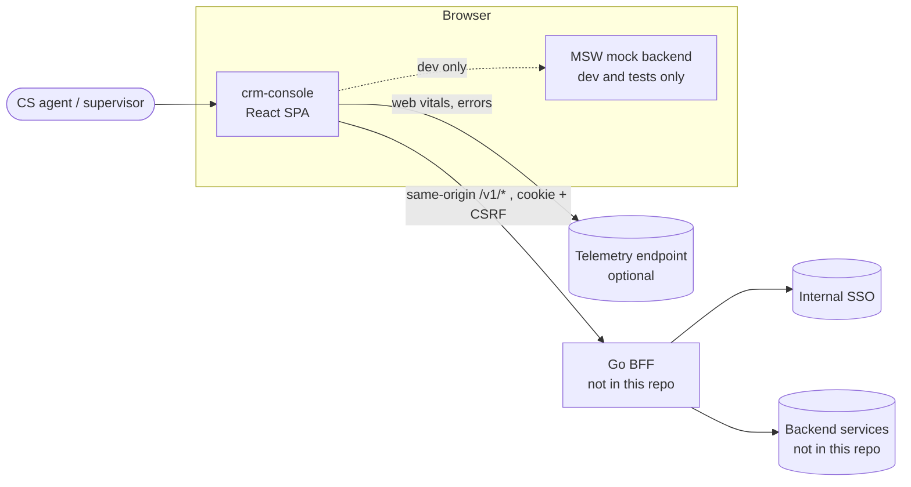
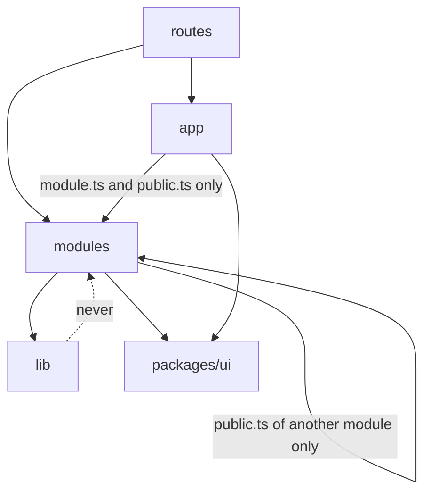
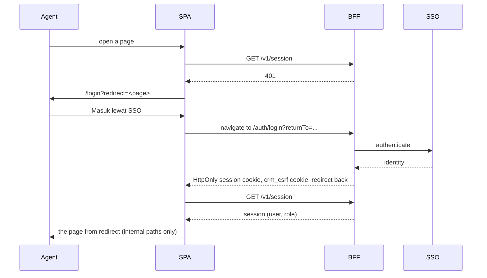

# System design

How the frontend is put together, and which standards keep it that way. It describes the code as it is on
`development`. Anything not built yet is marked **Proposed**. Decisions that are costly to reverse are in
[docs/adr](adr/README.md); the rules agents and developers follow are in [AGENTS.md](../AGENTS.md); UI
rules are in [docs/ui-standards.md](ui-standards.md).

## 1. Context

The product is a customer-service console for CS agents, supervisors, and admins (phase 1 is the case
record type `CS`). This repository is the frontend only.



- The browser talks only to the BFF, on the same origin. It never holds a token: the session is an
  `HttpOnly` cookie, and non-safe methods send `X-CSRF-Token`.
- The BFF owns authentication, authorization, and PII masking. The UI hides what a role cannot use and
  masks PII a second time; neither is a security boundary.
- Until the BFF exists, MSW answers every call in dev and in e2e. The mock is not shipped: production
  builds exclude it.

## 2. Structure

```text
apps/crm-console/src   the shell: no domain screens, loads remotes at startup
  routes/          URL files (TanStack Router, file-based): login, the authenticated layout, remote page routes
  app/             layout, auth, module registry and remote loader, design-system gallery (dev only)
  lib/             shell-only helpers (query client, telemetry, redirect)
  mocks/           MSW handlers, in-memory database, mock masking (dev only)
examples/crm-cs/src    example remote: customer service (Module Federation); examples are not part of the boilerplate
  modules/<id>/    case, customer: module.ts, public.ts, api/, queries/, schemas/, components/, pages/, store/
  routes.ts        code-based routes added under the shell's authenticated layout
packages/
  ui/              design system: components and tokens (@crm/ui)
  api-client/      OpenAPI contract, generated types, typed client
  auth/            roles, permissions, PII masking, AuthProvider
  app-kit/         helpers shared by the shell and the remotes: API client, env, format, SSE, query keys, requirePermission
  module-contract/ types of what a remote exposes (RemoteModule)
  i18n/            id-ID and en-US texts
  test-utils/      render helpers and the MSW setup for tests
  config-ts/ config-eslint/   shared configuration
```

### Boundaries (enforced by ESLint)



The same rules hold inside `examples/crm-cs`, which has `modules/` and `lib/` only. A remote never imports
the shell; what both need lives in a package (`app-kit`, `ui`, `auth`). A module never imports `app/` or `routes/`, and reaches another module only through its `public.ts`
(queries, schemas, store; never components). Cross-module links go through routes. Inside a module,
imports use the alias, not `../../`. A pattern needed by three modules moves to `lib/`, `packages/ui`, or
another package.

### The module contract

A module is a `ModuleDefinition` in the shell (`src/modules/types.ts`) and a `RemoteModule` in a remote
(`packages/module-contract`); the loader turns one into the other. It has: id, label key, icon, base path, navigation
target, the permission needed to see it, and optional slots (sidebar section, tab row, a real-time hook,
and an `onSignOut` cleanup) and, for a remote, `routes`. The shell knows only this shape.

How a remote joins: `main.tsx` loads the configured remotes (`VITE_REMOTE_MODULES`), registers their
modules, and only then builds the router, adding each remote's routes under `/_authenticated`
(`createAppRouter` in `src/router.tsx`). `@tanstack/react-router` is a shared singleton, so the remote's
routes, links, and hooks use the shell's router. The cost: routes of a remote are not in
`routeTree.gen.ts`, so links to them are not type-checked in the shell, and the shell's Tailwind build
scans the remote's source. Trade-offs: [ADR-0009](adr/0009-micro-frontends.md).

## 3. How data moves

| Concern            | Standard                                                                                                                                                                                       |
| ------------------ | ---------------------------------------------------------------------------------------------------------------------------------------------------------------------------------------------- |
| Server state       | TanStack Query. Query keys come from a per-module factory. Defaults: `staleTime` 30 s, no refetch on window focus, no retry on a 4xx                                                           |
| UI state           | Zustand, for UI only (open case tabs, unsent drafts). Never server data                                                                                                                        |
| Filters and paging | In the URL (search params validated by zod with `.catch()`), so a link or a reload restores the view                                                                                           |
| API calls          | Only through the module facade `modules/<id>/api/`, which wraps `@crm/api-client`. ESLint rejects `fetch` in modules, components, and routes                                                   |
| Business enums     | Status, queue, and priority come from `GET /v1/master-data`; the UI does not hardcode them ([ADR-0001](adr/0001-master-data-from-the-api.md))                                                  |
| Forms              | React Hook Form with a zod schema whose messages are i18n keys ([ADR-0003](adr/0003-forms-with-react-hook-form-and-zod.md))                                                                    |
| Real time          | Server-Sent Events (`@crm/app-kit` `sse.ts`, `useCaseStream`) update the query cache; the header shows the connection state                                                                    |
| Errors             | The client throws `ApiError` (`status`, `code`, `requestId`). A view shows `ErrorState` with a retry; a route error boundary catches render errors; unexpected errors go to the telemetry hook |

### The contract workflow

`packages/api-client/openapi/openapi.yaml` is the contract. Change it, run `pnpm codegen:api` (types in
`packages/api-client/src/generated`), add the client method, wrap it in the module facade, and update the
mock and [docs/contract-status.md](contract-status.md). CI fails if the generated types drift, and a test
fails if an operation is missing from the status table. **No endpoint is Stable yet**: the contract is
written here and reviewed with the backend owners as the BFF appears. GET endpoints can be wired with
`pnpm new:endpoint`.

### Sign-in, session, and sign-out



The BFF half is **Proposed**: it is not in this repository, and only the mock sign-in (`POST
/v1/dev/session`) exists today. What is built:

- A 401 from any query or mutation is handled once, in `lib/query-client.ts` and
  `app/auth/session-expiry.ts`: client data is cleared, drafts are kept for a re-login after expiry, and
  the user returns to `/login?redirect=...`. Pages do not handle 401.
- Signing out in one tab signs out the others (`BroadcastChannel`) and clears the query cache and each
  module's store.
- The `redirect` parameter accepts internal paths only (`lib/redirect.ts`).
- Routes check permissions with `requirePermission`; components use `can()` and `<Can>`, never a role
  name.

## 4. UI

Screens are built from `@crm/ui`; tokens live in `packages/ui/src/theme.css`; lint rejects raw controls and
palette colors ([ADR-0008](adr/0008-shared-ui-package.md), [docs/ui-standards.md](ui-standards.md)).
Texts are in both locales in `packages/i18n`, and a test rejects mismatched keys. Accessibility is WCAG 2.1
AA, checked by axe in e2e.

## 5. Quality and delivery

| Area          | Standard                                                                                                                                                              | Enforced by                                                                              |
| ------------- | --------------------------------------------------------------------------------------------------------------------------------------------------------------------- | ---------------------------------------------------------------------------------------- |
| Code          | TypeScript strict with `noUncheckedIndexedAccess`; no `any`; Prettier; Conventional Commits                                                                           | `pnpm typecheck`, ESLint, Prettier, commit hook                                          |
| Architecture  | The boundaries in section 2                                                                                                                                           | ESLint `no-restricted-imports`                                                           |
| Tests         | Unit and component tests next to the code (Vitest) with a coverage floor; critical flows in Playwright                                                                | `pnpm test` (floor in `vitest.config.ts`), `pnpm test:e2e`                               |
| Accessibility | WCAG 2.1 AA; axe scans of the main pages and the gallery                                                                                                              | `e2e/a11y.spec.ts`                                                                       |
| Performance   | Initial JS and every route (entry plus route chunk) at most 300 KB gzip; large tables virtualized; heavy libraries lazy-loaded                                        | `pnpm size`                                                                              |
| Security      | No tokens in web storage; CSRF header; PII masked by the server and again in the UI; no secrets in `VITE_*`; reviewed CSP                                             | review, `security-headers.inc` (CSP is report-only until tested with the BFF)            |
| Contract      | One OpenAPI file, generated types, a status per endpoint                                                                                                              | CI drift check, docs test                                                                |
| Delivery      | Branches `feature/`, `bugfix/`, `hotfix/`, `release/`; flow `development` to `staging` to `master`; a PR needs a green `pnpm check`, a reason, and screenshots for UI | CI: check, e2e, and image build (`nginx -t`, no source maps or mock worker in the image) |
| Dependencies  | Exact versions, Renovate with a seven-day release age; no package for a few lines of code                                                                             | `.npmrc`, `renovate.json`, review                                                        |

`pnpm check` runs everything CI runs (format, lint, typecheck, tests with coverage, build, size, contract
drift). The runtime is a static build served by nginx in a Docker image.

## 6. Extension points

| To add           | Do this                                                                     |
| ---------------- | --------------------------------------------------------------------------- |
| A module         | copy `modules/customer` in `examples/crm-cs`, then the steps in recipes     |
| A remote app     | `pnpm new:remote <id>`, then the steps it prints                            |
| A GET endpoint   | `pnpm new:endpoint <module> <operationId> --path /v1/...`                   |
| Another endpoint | the recipe in [docs/agents/recipes.md](agents/recipes.md)                   |
| A UI component   | "Changing or adding a component" in [docs/ui-standards.md](ui-standards.md) |
| A permission     | `packages/auth/src/roles.ts`                                                |
| UI text          | `packages/i18n/src/resources.ts`, both locales                              |

## 7. Open decisions

These are known gaps, not oversights:

- **The BFF contract.** No endpoint is Stable; the sign-in flow and `/auth/login` are Proposed.
- **The CS domain model.** The skeleton uses a generic model (four statuses, three queues, four roles).
  The record type `CS`, its taxonomy, tiers, and data scope are not applied.
- **Permissions per team.** Roles today are `l1`, `l2`, `supervisor`, and `admin`; permissions for other
  teams (for example Finance) are a business decision.
- **Scaling the frontend across teams.** The code is a modular monolith with enforced boundaries.
  Splitting it into micro frontends is under evaluation on a separate branch and is not adopted. The
  trigger for it is separate teams that must release on their own schedule, not code organization.
- **Production error reporting.** Errors go to a hook (`setErrorReporter`) with no vendor chosen.
