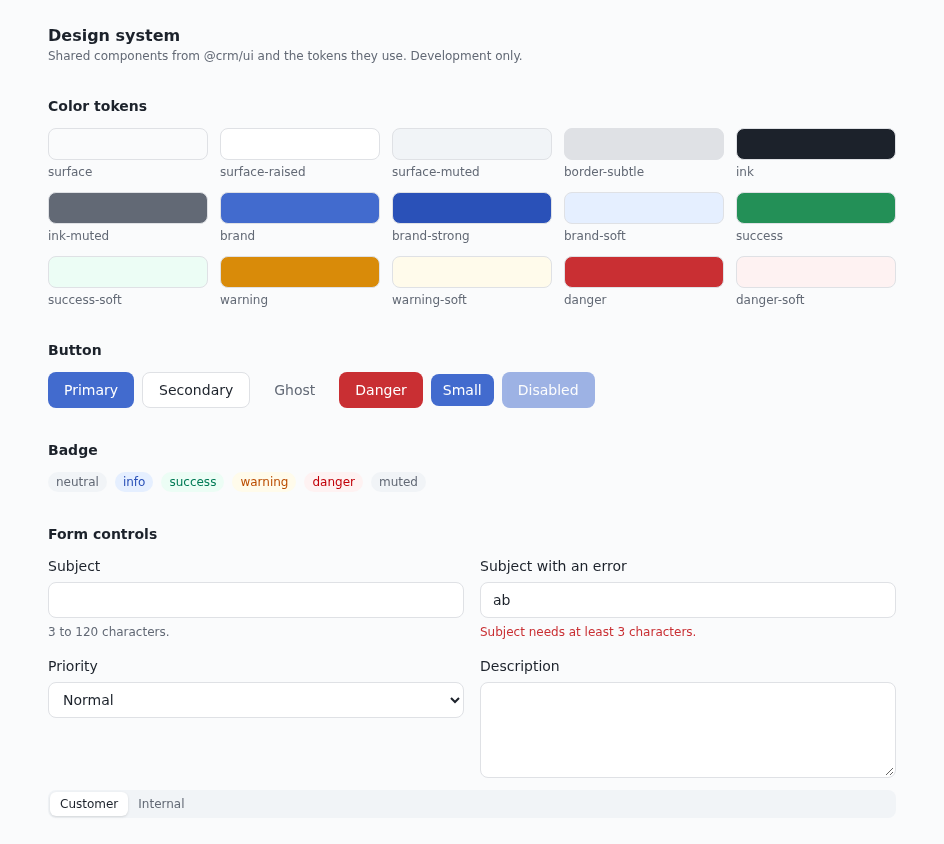

# UI standards

How screens are built here. The visual identity (colors, type, radii) is kept; this document makes the
way it is built consistent and reusable. Components and tokens live in `packages/ui` (`@crm/ui`); the
reason is in [ADR-0008](adr/0008-shared-ui-package.md). In development, open `/design-system` to see
every component in every state.

## The rule in one line

Build a screen from `@crm/ui`. If something you need is missing, add it to `@crm/ui`; do not write it
inline. Lint enforces two parts of this: a raw `button`, `input`, `select`, `textarea`, or table element
in an app, and a Tailwind palette color or hex value in a class string, are errors.

## Design tokens

Tokens are CSS variables defined in `packages/ui/src/theme.css` and used as Tailwind classes. Never use
`gray-500`, `emerald-700`, or `#hex`.

| Role    | Tokens                                             | Use for                                                                           |
| ------- | -------------------------------------------------- | --------------------------------------------------------------------------------- |
| Surface | `surface`, `surface-raised`, `surface-muted`       | page background, cards and inputs, hover and subtle fills                         |
| Text    | `ink`, `ink-muted`                                 | primary text; secondary text, captions, placeholders                              |
| Border  | `border-subtle`                                    | every divider and outline                                                         |
| Brand   | `brand`, `brand-strong`, `brand-soft`              | primary action, links and selection, info fills                                   |
| Status  | `success`, `warning`, `danger` (+ `-soft`, `-ink`) | solid: dots and icons; soft: badge background; ink: text on soft and message text |

Contrast, measured: `success-ink` on `success-soft` 5.09:1, `warning-ink` on `warning-soft` 4.88:1,
`danger-ink` on `danger-soft` 5.88:1, `brand-strong` on `brand-soft` 6.10:1 (WCAG AA needs 4.5:1 for
small text). The axe scans in `e2e/a11y.spec.ts` keep this true.

| Scale  | Standard                                                                                                                                                                                    |
| ------ | ------------------------------------------------------------------------------------------------------------------------------------------------------------------------------------------- |
| Type   | `text-xs` captions and meta; `text-sm` body and controls; `text-base` page titles; `text-lg` an item's own title. Weights: `font-medium` for labels and links, `font-semibold` for headings |
| Space  | Multiples of 4 px. Page padding `p-6`; card padding `p-4`; gaps `gap-2`, `gap-3`, `gap-4`                                                                                                   |
| Radius | `rounded-lg` controls, `rounded-xl` cards, `rounded-full` badges                                                                                                                            |
| Depth  | Flat by default; `shadow-sm` only for the selected option of a segmented control                                                                                                            |

The label/value caption style (small uppercase) is defined once, in `DescriptionItem` and `Th`. Changing
it changes every screen.

## Motion

Motion tokens live next to the color tokens in `packages/ui/src/theme.css`. Use them with Tailwind's
variable syntax, for example `transition-colors duration-(--motion-base) ease-(--motion-ease)`. Do not
write a raw millisecond value or a new cubic-bezier in a component.

| Token           | Value                        | Use for                               |
| --------------- | ---------------------------- | ------------------------------------- |
| `--motion-fast` | 150 ms                       | hover, press, and color changes       |
| `--motion-base` | 200 ms                       | small elements entering or leaving    |
| `--motion-slow` | 300 ms                       | panels and route changes              |
| `--motion-ease` | `cubic-bezier(0.2, 0, 0, 1)` | every transition that has a direction |

Animate only `transform` and `opacity`. With `prefers-reduced-motion: reduce` the three durations are
`0ms` and every transition or animation is cut to one frame, including Tailwind's own `duration-*`
utilities and the skeleton pulse. End-to-end tests run with reduced motion on; a test that needs motion
calls `page.emulateMedia({ reducedMotion: 'no-preference' })` (see `apps/crm-console/e2e/motion.spec.ts`).
Two patterns are built in. **Route crossfade:** changing page runs a view transition over `--motion-base` (`apps/crm-console/src/lib/view-transition.ts`). It is skipped when only the search changes (filtering and paging), when the agent prefers reduced motion, and in browsers that cannot skip it per navigation, because a view transition freezes the page while it runs. **Change flash:** `useChangeFlash(value)` returns true for a moment after the value changes while the component stays mounted (never on the first render); add `animate-change-flash` while it is true. Use it for a row or cell that someone else just updated, as `CaseTable` does with `updatedAt`.

The one exception is the sidebar: its width animates, which is layout work, because the page beside it has to follow. It is a single change the agent triggers, over `--motion-slow`. Measured on the case list (25 rows, headless Chromium): no frame over 17 ms at normal CPU speed, and one frame of 33 to 50 ms in 40 with the CPU slowed 4 times. It was not measured on a real low-end device; if it janks there, replace it with an instant width change and a fade of the content.
The wider plan is in [ui-motion-and-crm-components.md](ui-motion-and-crm-components.md).

## Components

| Component                                   | Use for                                                                                                                                                                                                            | Not for                                                                              |
| ------------------------------------------- | ------------------------------------------------------------------------------------------------------------------------------------------------------------------------------------------------------------------ | ------------------------------------------------------------------------------------ |
| `Button`                                    | any action; variants `primary`, `secondary`, `ghost`, `danger`; sizes `sm`, `md`, `icon`                                                                                                                           | navigation (use a link)                                                              |
| `Input`, `Select`, `Textarea`               | one form control each; wrap in `FormField` for a label, hint, and error                                                                                                                                            | a toggle of two states (use `SegmentedControl`)                                      |
| `FormField`                                 | wires label, hint, and error to its control (`id`, `aria-describedby`, `aria-invalid`)                                                                                                                             | layout                                                                               |
| `SegmentedControl`                          | a short either/or choice that changes behavior (who sees a reply)                                                                                                                                                  | more than about four options (use `Select`)                                          |
| `Badge`                                     | a status or category label, tone from master data                                                                                                                                                                  | actions                                                                              |
| `Card`                                      | a bordered group of related content; pass `as` for a landmark                                                                                                                                                      | page layout                                                                          |
| `DescriptionList`, `DescriptionItem`        | label and value pairs (a profile, a summary)                                                                                                                                                                       | tabular data with many rows                                                          |
| `Table`, `THead`, `TBody`, `Tr`, `Th`, `Td` | simple paged data                                                                                                                                                                                                  | thousands of rows (virtualize, see below)                                            |
| `Pagination`                                | previous and next with a page summary; the page lives in the URL                                                                                                                                                   | infinite scroll                                                                      |
| `Stack`, `Inline`                           | spacing between children: a column, or a wrapping row (`gap`, `align`, `justify`)                                                                                                                                  | margins between siblings                                                             |
| `StatCard`                                  | one figure with its name; put a link in the value for a drill-down                                                                                                                                                 | prose                                                                                |
| `SectionHeading`                            | the heading of a section inside a page                                                                                                                                                                             | the page title (use `PageHeader`)                                                    |
| `Page`, `PageHeader`                        | a scrollable page body with a readable width; a title, one purpose line, and actions                                                                                                                               | full-bleed tools like the case list                                                  |
| `Alert`                                     | a short message tied to the content next to it; `danger` interrupts, other tones are polite                                                                                                                        | page-level failure (use `ErrorState`)                                                |
| `toast()`, `Toaster`, `ToastCard`           | a short confirmation that does not belong to one spot (a saved update); mount one `Toaster` in the shell and call `toast(message, { tone })` from any module; errors stay until closed                             | an error next to a form field (use `FormField`) or a page failure (use `ErrorState`) |
| `Tooltip`                                   | a visual hint for a trigger whose text is hidden (an icon-only menu item); the trigger must already have an accessible name, because the bubble is hidden from assistive technology and Escape does not dismiss it | information the trigger does not already carry                                       |
| `Drawer`                                    | a side panel to look at one record without leaving the list (mount it to open, unmount in `onClose`); native modal `<dialog>`, so Escape and focus trapping come from the browser                                  | a form that must not be dismissed by a stray click or Escape                         |
| `EmptyState`, `ErrorState`, `Skeleton`      | nothing to show; the request failed (with retry); loading                                                                                                                                                          | inline field errors (use `FormField`)                                                |
| `TextLink`, `textLinkClasses`               | a text link; `inline` underlines it inside running text                                                                                                                                                            | buttons                                                                              |

## Composition rules

- Use `cn` for conditional classes. Extend a component through `className`; do not fork it.
- A pattern written twice in different features is a candidate for `@crm/ui`; promote it at the latest
  when it is needed a third time or by another app. Domain components (a case timeline) stay with their
  feature until then.
- A table that can hold thousands of rows is virtualized (`useVirtualizer`) and lives with its feature;
  disable the raw-element lint rule on that line and say why.
- Components in `@crm/ui` are styling and behavior only: no API calls, no feature imports, no hard-coded
  business values (status and queue labels come from master data).

## States

Every data view handles all of these, with the same components each time.

| State           | Pattern                                                                                        |
| --------------- | ---------------------------------------------------------------------------------------------- |
| Loading         | `Skeleton` blocks shaped like the content, in a container with `aria-busy="true"`              |
| Empty           | `EmptyState` with a title, one sentence of direction, and an action when there is one          |
| Error           | `ErrorState` with a retry for a view; `Alert` for a failed action next to its control          |
| Saving          | The button is disabled and says what is happening; on success an `Alert` with `tone="success"` |
| Not allowed     | Hide what the role cannot use (`<Can>`); the server still decides                              |
| Session expired | Not handled per page: the global 401 handler sends the user to sign in                         |

## Forms

Follow [ADR-0003](adr/0003-forms-with-react-hook-form-and-zod.md): React Hook Form, a zod schema whose
messages are i18n keys, and `FormField`. A field has a visible label (never only a placeholder), a hint
when the format is not obvious, and an error that says what to change. Validate on submit first, then on
change. The submit button names the action ("Buat case", not "Submit"); the cancel button is `ghost`.

## Lists and tables

Filters, sort, and page live in the URL (`validateSearch` with `.catch()`); the list reads them and the
controls write them. Page sizes are 25, 50, and 100. A row's main link is a `TextLink` or the router
`Link` with `textLinkClasses`. PII columns go through the masking helpers.

## Writing

- Sentence case. Plain verbs. No filler.
- A button names what happens ("Simpan perubahan"), and the same action keeps the same name through the
  whole flow: the button that says "Kirim" produces a message that says "Terkirim".
- An error says what went wrong and what to do. It does not apologize and is never vague.
- An empty screen invites an action.
- Name things the way the agent does ("case", "antrean"), not the way the system is built.
- Texts live in both locales: `packages/i18n/src/resources.ts` for the shell, a remote's own `src/texts.ts` for its screens (the `id-ID` text is the product text).
  Dates and numbers go through `Intl` or `@crm/app-kit` (`format.ts`), never string concatenation.

## Accessibility (WCAG 2.1 AA)

- Every control has an accessible name; icon-only buttons have `aria-label`.
- Focus is always visible; the global `:focus-visible` rule is in the theme. Do not remove it.
- Color is never the only cue: a link inside running text is underlined (`TextLink inline`), a status
  badge carries text.
- Use an ARIA role only with its full pattern. Prefer the native element.
- Messages: `Alert` uses `role="alert"` for errors and `role="status"` for the rest.
- Motion answers an action (open, expand, confirm). No decorative entrance animation. Respect
  `prefers-reduced-motion`.
- `e2e/a11y.spec.ts` scans the main pages and the gallery with axe. A new component state goes into the
  gallery so it is scanned.

## Responsive

The console is a desktop tool (a width of 1024 px and up is the target), but layouts must not break at
narrow widths: use wrapping flex and grid, let a table scroll horizontally inside its container, keep
touch targets at least 32 px tall, and check the gallery at a narrow width when you change a component.

## Micro frontend remotes

A remote builds its screens from `@crm/ui` only and writes no Tailwind utilities of its own: the CSS it
needs comes from the host, which compiles the classes it can see, so a class the host never saw renders
unstyled. Share `@crm/ui` as a singleton across the host and the remotes so component code and CSS always
come from the same build. Remote CSS, if any, uses the tokens and prefixes every class with the module id.
The consequence is that a remote cannot restyle itself on its own: a new component, a new variant, or a
design change needs a new host build, so remote independence covers logic and data, not appearance.

## Changing or adding a component

1. Write it in `packages/ui/src/<name>.tsx`, styling and behavior only, tokens only.
2. Export it from `packages/ui/src/index.ts`.
3. Add `<name>.test.tsx` next to it (roles, states, keyboard where it applies).
4. Add it, in every state, to `apps/crm-console/src/app/design-system/Gallery.tsx`.
5. Add a row to the component table above.
6. Run `pnpm check` and `pnpm test:e2e`.

## Review checklist for a UI change

- Built from `@crm/ui`; nothing inline that a component already covers.
- Loading, empty, error, and success states exist.
- Labels, focus, and keyboard work; no color-only cue.
- Text is in both locales and follows the writing rules.
- Looks right at a narrow width and with long text.
- New or changed component: test, gallery entry, and this document updated.
