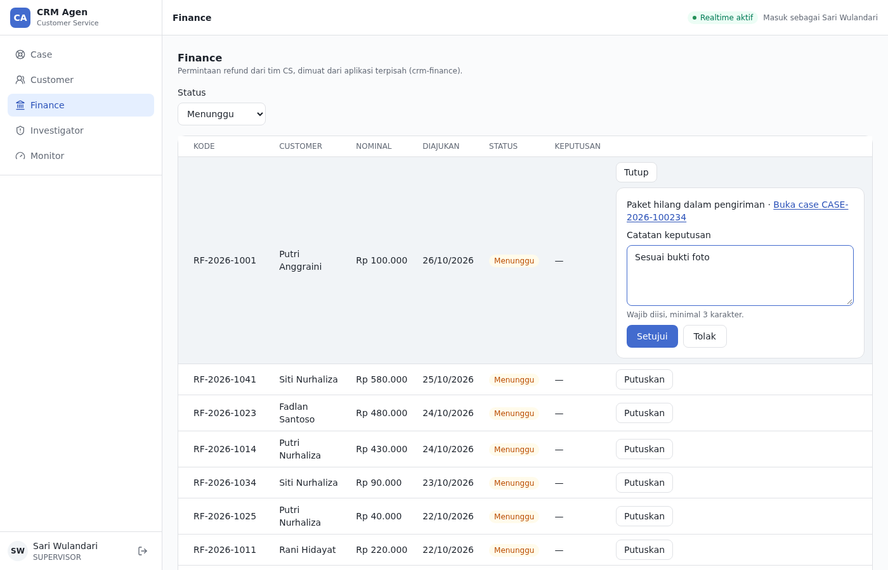
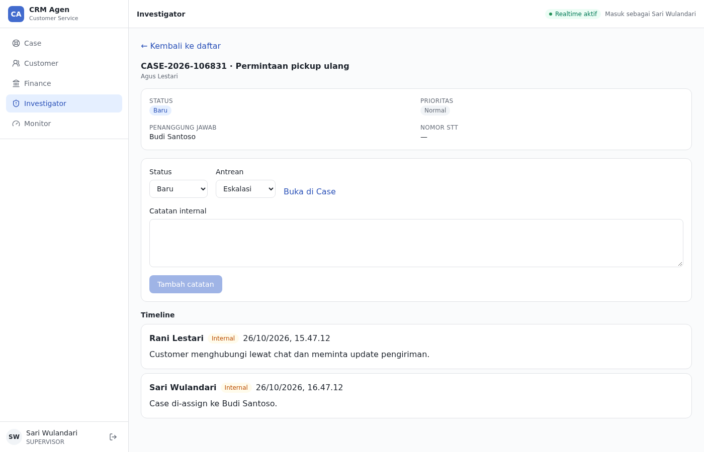
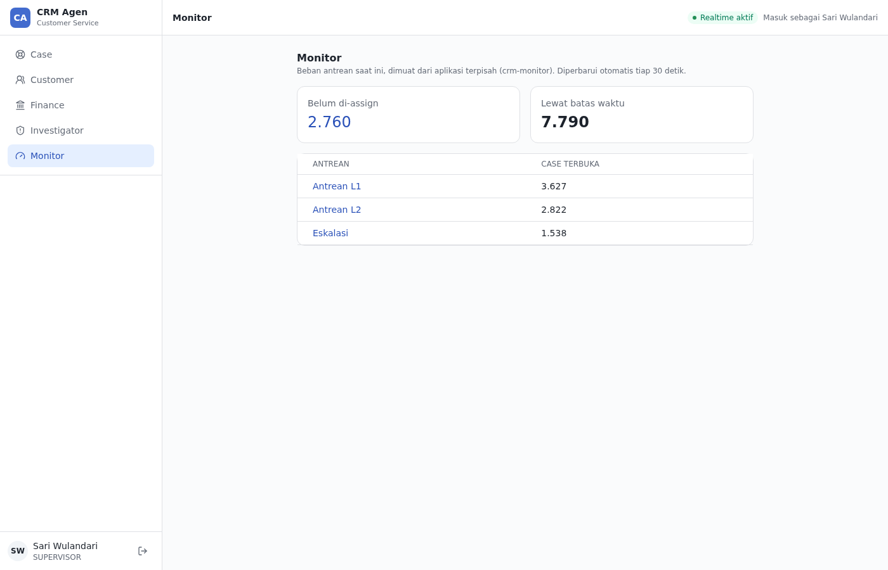
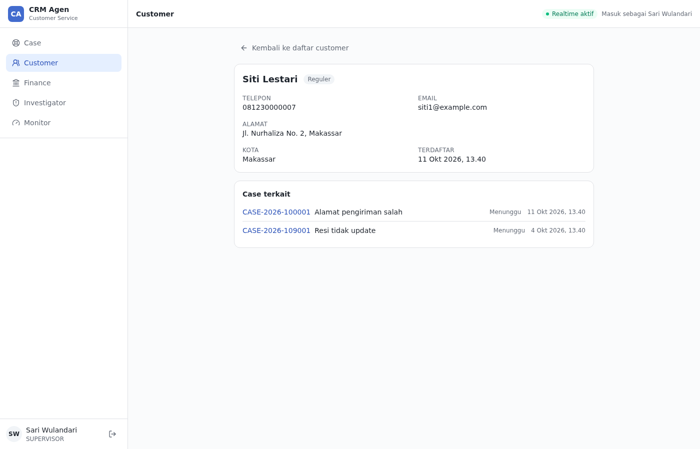

# Examples

Working remotes that show how a domain plugs into the console. They are examples, not part of the
boilerplate: the console (`apps/crm-console`) runs without any of them and shows an empty state.
They live in `examples/`, are part of the workspace, and are checked by `pnpm check` so they do not
rot. All data is mock (the mock backend still lives in the console; moving it is planned).

| Example                                             | What it shows                                                              |
| --------------------------------------------------- | -------------------------------------------------------------------------- |
| `examples/crm-cs`                                   | A full domain: Case and Customer with their own routes (`/cases`)          |
| `examples/crm-finance`                              | A one-page remote under `/remote/finance`                                  |
| `examples/crm-investigator`, `examples/crm-monitor` | More one-page remotes, linked to the others                                |
| `examples/e2e`                                      | Journeys across the console and the examples (not the console's own tests) |

It is not an accepted architecture decision; the proposal and its costs are in
[ADR-0009](../docs/adr/0009-micro-frontends.md).

| Finance (decision panel)           | Investigator (detail and actions)                          |
| ---------------------------------- | ---------------------------------------------------------- |
|  |  |
| **Monitor**                        | **Customer (case history)**                                |
|  |                        |

## What each menu does

The CS remote (`examples/crm-cs`) contributes real routes (`/cases`, `/customers`) instead of one page
under `/remote/<id>`, like the other three; see "How it works" and
[ADR-0009](../docs/adr/0009-micro-frontends.md).

| Menu         | Where it lives              | Permission      | Flow                                                                                                                              |
| ------------ | --------------------------- | --------------- | --------------------------------------------------------------------------------------------------------------------------------- |
| Case         | `examples/crm-cs`           | `case.view`     | List with filters, create a case, detail with timeline, reply, change status or priority, assign to me, **move to another queue** |
| Customer     | `examples/crm-cs`           | `customer.view` | List, profile with PII masked by role, **case history** with links to each case                                                   |
| Finance      | `examples/crm-finance`      | `case.export`   | Refund requests: filter by status, approve or reject with a required note, who decided and when, link to the case                 |
| Investigator | `examples/crm-investigator` | `case.escalate` | Escalated cases: list with paging, detail, add an internal note, change status or queue, open the case in Case                    |
| Monitor      | `examples/crm-monitor`      | `case.reassign` | Queue load: unassigned, overdue, open per queue; queues and unassigned link to the filtered Case list; refreshes every 30 seconds |

The menus are connected by what a user does, not only by shared data: an L2 agent or supervisor
moves a case to the escalation queue in **Case**, it shows up first in **Investigator**, an
investigator adds a note and changes the status, **Case** shows both without a reload, and
**Monitor** links to the filtered list. Finance reaches the case of a refund the same way.

### What was invented, and what was not

Be clear about this when presenting:

- **Real, from the existing contract:** everything in Case, Customer, Investigator, and Monitor
  except the two additions below. They use `GET /v1/cases`, `GET /v1/cases/{caseId}`,
  `PATCH /v1/cases/{caseId}`, `POST /v1/cases/{caseId}/replies`, `GET /v1/cases/summary`,
  `GET /v1/customers`, and `GET /v1/master-data`.
- **Small additions to the existing contract (Proposed):** an optional `customerId` filter on
  `GET /v1/cases` (customer history) and an optional `refundStatuses` list in master data.
- **Invented for the PoC (Proposed, mock only): the whole Finance domain.** `GET /v1/finance/refunds`
  and `PATCH /v1/finance/refunds/{refundId}`, the refund fields, the statuses (pending, approved,
  rejected), the `409` for an already decided refund, and the seed data. Nobody agreed on any of it.
  The rows are marked **Proposed** in `docs/contract-status.md`.
- **Stand-in permissions.** `case.export`, `case.escalate`, and `case.reassign` already exist and
  were reused, so the PoC makes no business decision. A permission per team is for the product
  owners. The queue code `escalated` is an assumption; if master data lacks it, Investigator says
  so instead of showing another queue.
- **Mock data quirk.** The last 1,000 cases share customers with the first 1,000, so a customer
  profile can show a history. Case ids and codes did not change.

## Demo script (about five minutes)

Run `pnpm dev:examples` and open http://localhost:5173 (signed in as supervisor, all five menus).

1. **Case:** open a case, change its queue to _Eskalasi_ ("Antrean" select).
2. **Investigator:** the case is first in the list. Open it, add an internal note, set the status to
   _Menunggu_. Click _Buka di Case_: the note and the status are already there. This menu is a
   different app, loaded at runtime.
3. **Monitor:** click _Eskalasi_: the host opens the escalation queue of Case.
4. **Finance:** filter _Menunggu_, click _Putuskan_, try the buttons without a note (disabled), write
   a note, approve one and reject another, then filter _Disetujui_ and _Ditolak_.
5. **Customer:** open a profile, see the case history, click a case.
6. **Other teams:** open `http://localhost:5173/cases?role=l1` (then `l2`): the menu changes, and a
   direct URL such as `/remote/monitor` goes back to Case.
7. **Resilience:** stop one remote (for example the process on port 5175), reload: the other
   menus keep working and the stopped one disappears.

Data lives in page memory, so a reload resets it. Stay in the app by clicking while you demo.

## The remotes

| App                         | Port (dev / preview) | Module id      |
| --------------------------- | -------------------- | -------------- |
| `examples/crm-finance`      | 5174 / 4175          | `finance`      |
| `examples/crm-investigator` | 5175 / 4176          | `investigator` |
| `examples/crm-monitor`      | 5176 / 4177          | `monitor`      |

## What it proves

| Claim                                                                 | Evidence                                                                                                                                                                                                    |
| --------------------------------------------------------------------- | ----------------------------------------------------------------------------------------------------------------------------------------------------------------------------------------------------------- |
| Separate apps plug modules into the console at runtime                | Each remote is built and served on its own; the host loads its `remoteEntry.js` in the browser                                                                                                              |
| Remotes appear in the navigation through the existing module contract | Each remote exports a module definition (id, label key, icon, path, permission)                                                                                                                             |
| One React, one session, one `QueryClient`, one i18n instance          | Remote pages use hooks, show the signed-in user, and write to the host cache; no React chunk is downloaded per remote                                                                                       |
| A remote can ship its logic and data on its own                       | Change a remote's logic, texts, or how it composes `@crm/ui` components, rebuild only that app, reload the host: the change shows, the host is untouched. **Not** its look: see "Visual independence" below |
| Different teams see different things                                  | See the role matrix below, including direct URLs                                                                                                                                                            |
| A remote can own routes under its prefix                              | Investigator has a list at `/remote/investigator` and details at `/remote/investigator/case/<id>`; deep links survive a hard reload                                                                         |
| Remotes use the host's API client                                     | Same session, CSRF handling, and PII masking as built-in modules; no second client                                                                                                                          |
| Remotes and host can open each other's pages                          | `openHostPath` goes from a remote to a host path (Case, filtered lists); Case links into the remotes through the menu                                                                                       |
| Failures are contained                                                | Stop one remote: the others and the host keep working. Stop all: the host works, remote paths show "Modul tidak tersedia"                                                                                   |
| The host's session handling covers remotes                            | A 401 on a remote's query sends the user to `/login?redirect=/remote/...`; signing out clears the remotes' cached data                                                                                      |
| The menu is stable                                                    | Remotes load in parallel but register in the configured order, so the menu does not depend on which answered first                                                                                          |

### Role matrix (mock roles)

| Role         | Menu                                           | `/remote/finance` | `/remote/investigator` | `/remote/monitor` |
| ------------ | ---------------------------------------------- | ----------------- | ---------------------- | ----------------- |
| `l1`         | Case                                           | back to `/cases`  | back to `/cases`       | back to `/cases`  |
| `l2`         | Case, Customer, Investigator                   | back to `/cases`  | opens                  | back to `/cases`  |
| `supervisor` | Case, Customer, Finance, Investigator, Monitor | opens             | opens                  | opens             |

## How it works

```text
packages/module-contract   types only: RemoteModule (what a remote exports), RemotePageProps (what it gets)
apps/crm-console             host: shell, session, routing, shared singletons
  src/router.tsx                 createAppRouter(): adds the routes of loaded remotes under /_authenticated, once, after the remotes load
examples/crm-cs                  CS remote: modules case and customer, code-based routes.ts, port 5177
  vite.config.ts             federation plugin, no remote listed (the build does not need one)
  src/app/modules/remote.ts      reads VITE_REMOTE_MODULES, loads each `<name>/module`, registers in order
  src/app/modules/registry.ts    registerRemoteModule(): ignores an id or path that is taken, with a warning
  src/app/modules/guard.ts       beforeLoad guard: permission comes from the loaded module
  src/app/modules/RemoteModulePage.tsx   gives the page `api`, `subPath`, `navigate`, `openHostPath`; or "unavailable"
  src/routes/_authenticated/remote/$moduleId/   index and splat routes, one pair for every remote
  src/mocks/browser.ts           dev only: `?role=l1` opens the app as that role
examples/crm-finance, crm-investigator, crm-monitor   remotes: expose ./module, add their own i18n texts
```

- **Tool:** `@module-federation/vite` 1.23.5 (Vite 8 is in its peer range) and
  `@module-federation/runtime` 2.9.2 in the host, both pinned.
- **Runtime registration:** the host does not know a remote at build time. URLs come from
  `VITE_REMOTE_MODULES` (`name=entryUrl`, comma separated; empty means no remotes), so one host
  build can point to different remotes per environment.
- **What the host gives a remote page** (`RemotePageProps`): `api` (the host's API client),
  `subPath` (the path below `/remote/<id>/`), `navigate(subPath)` (inside the remote's own prefix,
  no reload), and `openHostPath(path)` (a host page such as `/cases/case-00001`; only internal
  paths are accepted, through the same `safeRedirectPath` that protects the login redirect). Remote
  links keep a real `href` so "open in a new tab" works.
- **Shared singletons** (`react`, `react-dom`, `react-i18next`, `@tanstack/react-query`,
  `@tanstack/react-router` and `@crm/app-kit` for the CS remote, `@crm/auth`, `@crm/ui`): the host and every remote declare the same list. Anything that holds state or
  context must be shared, or hooks break and contexts split. `@crm/module-contract` is type-only,
  so it is never bundled or shared.
- **The CS remote and Tailwind:** it uses utility classes of its own, so the host's Tailwind build scans
  `examples/crm-cs/src` (`@source` in `apps/crm-console/src/styles.css`). A second Tailwind build in the remote was tried and
  broke the utility order (a late `.hidden` beat the shell's `lg:flex`), so there is one sheet. A new class in the CS
  remote therefore needs a new host build.
- **Styling:** a remote is built from `@crm/ui` components and writes no CSS and no Tailwind
  utilities of its own. The host compiles the classes (it scans `packages/ui`), and `@crm/ui` is a shared
  singleton, so component code and CSS always come from the same build. A remote that needs a layout
  or a pattern the package lacks adds it to `packages/ui` (Stack, Inline, StatCard, SectionHeading,
  Skeleton sizes, and a no-wrap table cell came from exactly this). Lint enforces the rest: no raw
  controls and no palette colors in a remote.
- **Failure handling:** loading has a 5 second timeout (20 in dev, where a remote is compiled on
  first request) and any failure is logged with `console.error`; the host starts without that remote.

## Run it

```bash
pnpm install
pnpm dev:examples          # console :5173 (mock backend) + the four examples
```

Open http://localhost:5173. The mock signs in as supervisor. To see another team's view, add
`?role=l1` (or `l2`, `supervisor`) to the URL; it is read once when the page loads, and signing out
and in again returns to the role from `VITE_MOCK_ROLE`. `pnpm dev` starts the console alone, which shows an empty state. To load a production build of one remote:

```bash
pnpm --filter @crm/crm-finance build
pnpm --filter @crm/crm-finance preview        # serves dist on :4175
VITE_REMOTE_MODULES=crm_finance=http://localhost:4175/remoteEntry.js pnpm dev
```

`dev:examples` sets the variable inline, which works in bash and zsh (Linux, macOS, WSL). It uses
`--no-bail`, so stopping one remote does not stop the host or the others.

### Tests

`pnpm test:e2e:mfe` runs `examples/e2e/mfe/` against the host and the four remotes
(config: `examples/e2e/playwright.mfe.config.ts`; servers that are already running are reused).
It is not part of CI. `pnpm test:e2e` runs the console's own tests plus the CS journeys
(`examples/e2e/cs/`), and CI runs that. It covers the journey across menus, the
Finance decisions, the customer history, the role matrix, and axe scans (WCAG 2.1 AA) of every
remote page. `pnpm check` builds every example but needs none of them running.

## Add another remote

Run `pnpm new:remote <id>` (see the recipe "Add a remote" in `docs/agents/recipes.md`); it creates
`apps/crm-<id>`. Keep the `shared` list identical to the console's `vite.config.ts`; add a library there
only in both places at once.

Rules for a remote:

- Import no host code (`@/...`); everything it shares comes from the singletons and `RemotePageProps`.
- **Id and path:** a module whose id or `basePath` is already taken is ignored with a warning.
- **i18n:** write only under your own module id. The merge uses `overwrite`, so a remote could
  replace a host text; nothing enforces the namespace.
- **UI:** build screens from `@crm/ui` only. Write no CSS and no Tailwind utilities: a class the
  host never compiled renders unstyled. If something is missing, add it to `packages/ui`.
- **Query keys:** prefix your own with the module id. After a write, a remote that must refresh
  host views has to invalidate the host's keys itself (Investigator invalidates `['cases']`), which
  couples it to the host's key names. The host's own invalidations do not refresh a remote's view,
  so remote pages refetch when opened (`staleTime: 0`).

## What it does not cover

- **Visual independence.** A remote has no CSS of its own: it uses `@crm/ui`, shared as a singleton, and
  the host's Tailwind build creates the styles, only for the classes it saw at build time. Opened alone,
  a remote renders unstyled. A remote can recompose existing components freely, but a new component, a
  new variant, or a design change in `@crm/ui` needs a new host build (and a release of the package).
  So "a remote releases on its own" holds for logic and data, not for appearance. Presenting this as
  full independence would overstate it.
- **Production hosting.** A production host build has no mock backend, so signing in needs the real
  BFF. Remotes must be served over HTTPS with CORS allowing the host origin, and the CSP in
  `security-headers.inc` (`script-src 'self'`) must allow their origins. CI, Docker, and nginx are
  not changed in this PoC.
- **Versioning.** Host and remotes share singletons by name only. A breaking change in a shared
  library (for example React) or in `@crm/module-contract` needs a coordinated release; nothing
  here enforces it. Changing the contract already forces every remote to change.
- **Real-time.** The mock has no event stream (set `VITE_MOCK_EVENTS=true` to simulate it in the
  host), so remote views refresh on open or on a timer, not by push.
- **Escalation scope.** Investigator lists every case in the escalation queue (all statuses), while
  Monitor counts open cases; which view a team needs is a domain decision.
- **Finance beyond the PoC.** No refund creation from a case, no amounts or limits per role, no
  audit trail beyond the decision note.
- **Tests.** The host side (loader, registry, guard, page, props, customer history) has unit tests.
  The remotes have no unit tests; their behavior is covered by the `examples/e2e/mfe` suite described above.

## Security: a remote is not isolated from the host

A loaded remote runs in the same page as the console, with the same React, session, and
`QueryClient` cache. That is what the PoC demonstrates on purpose, and it has a consequence:

- Remote code can read anything in the shared cache, including customer data (phone, email,
  address), and can call the API with the signed-in user's session.
- Splitting a team into a remote therefore **adds no data protection**. What limits access is still
  the permission checks and PII masking on the server/BFF, as `AGENTS.md` requires. The menu and
  route guards in the host only hide things.
- A remote's code runs in every user's browser, so only load remotes from teams and servers that
  are fully trusted, and keep the allowed origins in the CSP and CORS configuration.
- If one team's data must be isolated from another's, that needs a genuinely separate app and
  domain (no shared page, session scope, or cache), not a micro frontend.

## Cost to weigh

Every point under "What it does not cover" is work a plain modular monolith does not have. The
module boundaries and per-role navigation that already exist deliver most of the benefit while one
team owns the console. Independent deployment, the thing only a micro frontend gives, pays off when
separate teams need to release on their own schedules.
